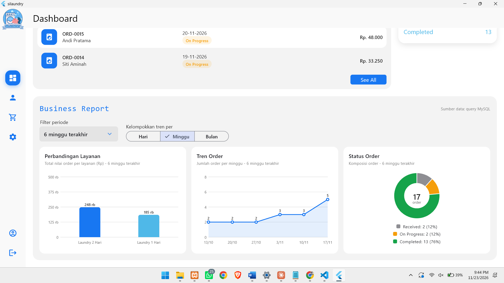
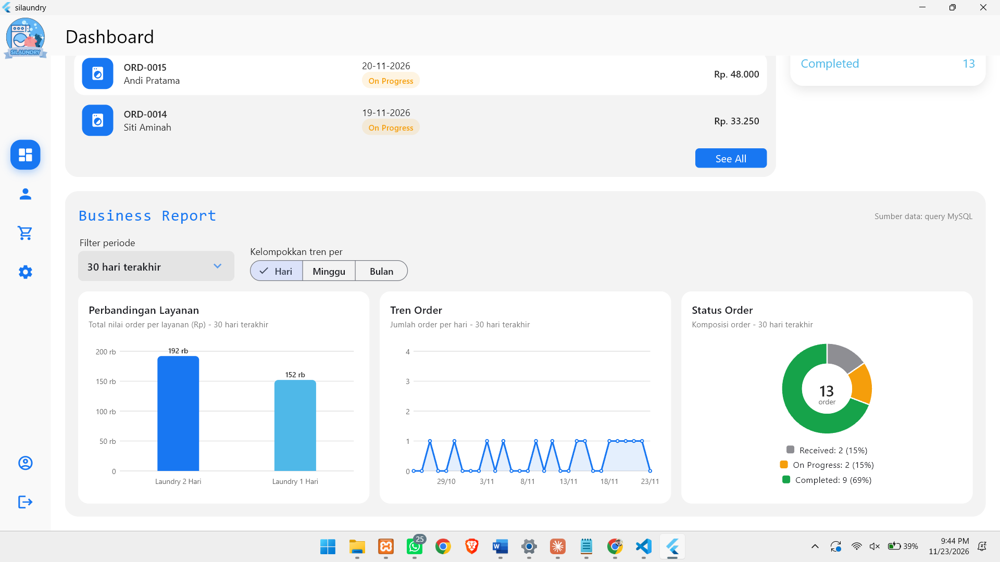

# SiLaundry - Aplikasi Desktop Manajemen Laundry (Flutter + MySQL)

Aplikasi desktop Windows untuk mengelola usaha laundry, dibuat dengan **Flutter (Dart)** dan
database **MySQL (XAMPP)**. Ada dua peran: **Admin** (kelola customer, order, layanan, dan
melihat laporan) dan **Customer** (membuat order dan membayar). Di halaman login pilih Customer
atau Admin.

## Dashboard Laporan (Data Reporting)

Dashboard admin memiliki bagian **Business Report** yang datanya diambil dari database MySQL
lewat query SQL (JOIN, WHERE, dan GROUP BY).

*Dashboard admin: ringkasan, filter periode, pengelompokan tren, dan tiga grafik.*

*Hasil setelah filter periode dan pengelompokan tren diganti.*

### Pemenuhan indikator penilaian

| Indikator | Pemenuhan | Letak kode |
|---|---|---|
| 1. Data diambil dari database dengan query yang sesuai | Tiga query SQL berbeda (JOIN `services` + `order_items` + `orders`, GROUP BY). Pojok kanan atas Business Report menampilkan "Sumber data: query MySQL" | `lib/shared/data/db_service.dart` (`_sqlReport...`), dipanggil `appState.loadReport()` di `lib/shared/data/app_state.dart` |
| 2. Fitur data filtering atau data grouping | **Filtering:** dropdown *Filter periode* (7, 14, 30, 42, 90 hari terakhir), diterapkan ke ketiga grafik lewat `WHERE order_date >= ...`. **Grouping:** *Kelompokkan tren per* Hari / Minggu / Bulan pada line chart (`GROUP BY` berbeda), dan GROUP BY layanan serta status | `lib/admin/pages/dashboard_page.dart` (kontrol), `db_service.dart` (query) |
| 3. Minimal 3 jenis chart | **Bar chart** (perbandingan layanan), **line chart** (tren order), **pie chart** (komposisi status order) | `lib/admin/widgets/charts.dart` |

| Grafik | Isi | Query |
|---|---|---|
| Bar chart | Total nilai order per layanan (perbandingan produk) | `services` LEFT JOIN `order_items` JOIN `orders`, `GROUP BY` layanan |
| Line chart | Jumlah order per hari, minggu, atau bulan | `orders`, `GROUP BY` hari/minggu/bulan |
| Pie chart | Komposisi order per status | `orders`, `GROUP BY status` |

Query yang sama dapat dijalankan manual di phpMyAdmin: `database/silaundry.sql` bagian 6
(ubah `@days_back` untuk filter periode). Grafik dimuat ulang otomatis saat ada order baru
atau status order berubah.

## Fitur transactional

"Buat Order" menulis ke tabel `orders` dan `order_items` dalam satu transaksi
(`START TRANSACTION` ... `COMMIT`, atau `ROLLBACK` jika ada yang gagal). Lihat method
`insertOrder` di `lib/shared/data/db_service.dart`.

## Tabel dan relasi

    customers 1 --- N orders        (orders.customer_id -> customers.id)
    orders    1 --- N order_items   (order_items.order_id -> orders.id)
    services  1 --- N order_items   (order_items.service_id -> services.id)
    admins                          (akun admin)

## Cara menjalankan (Windows + VS Code)

1. Buka **XAMPP Control Panel**, klik **Start** pada **MySQL**.
2. Clone repositori ini, lalu di folder proyek jalankan:

       flutter pub get
       flutter pub add mysql_client

3. Buka `lib/shared/data/db_service.dart`, kelas `DbConfig`, lalu sesuaikan dengan MySQL-mu:
   host `127.0.0.1`, **port** (bawaan XAMPP 3306), user `root`, **password**, dan database
   `silaundry_app`.
4. Jalankan `flutter run -d windows`. Harus Windows desktop (bukan Chrome).

Database `silaundry_app` dan 5 tabelnya dibuat otomatis saat pertama dijalankan, lalu diisi data
contoh (18 order dalam 6 minggu agar grafik terisi). Jika sudah terisi data lama dan ingin
mengulang, jalankan `DROP DATABASE silaundry_app;` di phpMyAdmin lalu jalankan aplikasi lagi.
Di halaman login tampil "Database MySQL aktif - data tersimpan" jika koneksi berhasil.

### Akun demo

| Masuk sebagai | Username | Password |
|---|---|---|
| Admin | `admin` | `admin12345` |
| Customer | `budi01` | `rahasia12345` |

## Struktur folder

    lib/
      main.dart
      admin/              khusus admin
        pages/            dashboard, customers, orders, service list, dst.
        widgets/          sidebar, dialog, charts.dart (bar, line, pie chart)
      customer/           khusus customer
        pages/            dashboard, orders, checkout, payment, dst.
        widgets/          sidebar, dialog
      shared/             dipakai admin dan customer
        auth/             login, register
        data/             models.dart, app_state.dart, db_service.dart (semua SQL)
        widgets/          komponen umum
        theme.dart
    database/silaundry.sql   skema, contoh transaksi, dan query laporan
    docs/                    gambar untuk README
